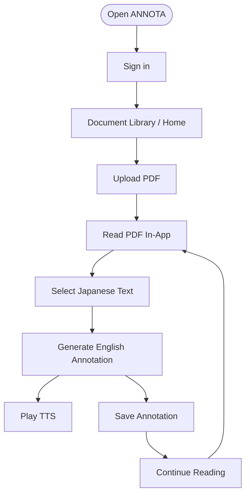
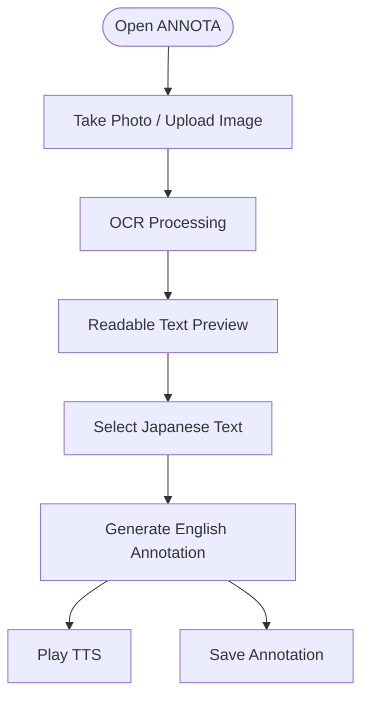
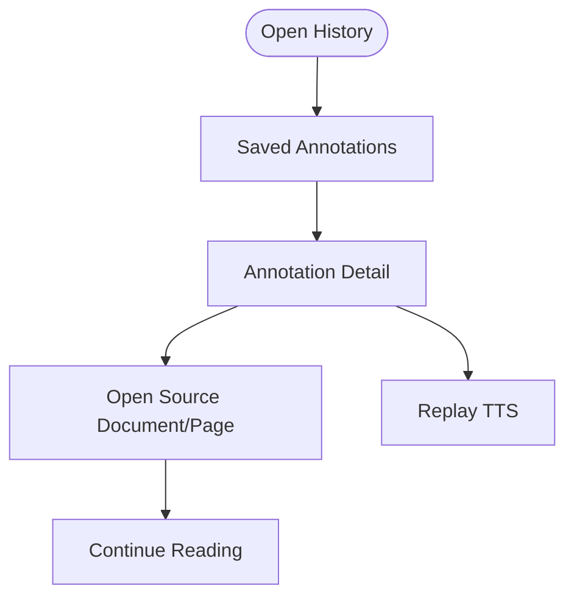

# ANNOTA Product Requirements Document

## 0. Beta MVP: 10 Invited Testers

This section is the launch contract for the first closed beta. It narrows the roadmap below to the loop that ten invited testers must be able to complete on their own phones. Everything outside §0 is roadmap, not a beta commitment. Where §0 and a later section disagree, §0 wins for the beta.

### 0.1 Beta scope

**In scope (the beta loop):**

1. Sign in with an invited account (Google or email).
2. Scan a physical book page with the camera, or upload a photo, and read the OCR text.
3. Highlight a word, phrase, or sentence in the OCR text and get an English explanation plus Japanese audio for how it is read.
4. Save the explanation.
5. Reopen a past scan and read its OCR text again without re-scanning.
6. Browse history: past scans and saved explanations.
7. See the remaining daily allowance and understand what happens when it runs out.
8. Delete a scan, a saved explanation, or the whole account.

**Available but not a beta acceptance target:** the PDF reader, document library, and reading progress. They stay in the app and may be used by testers, but a PDF-only defect does not block the beta.

**Out of scope for the beta** (in addition to §16): invitation self-service or admin UI, explanation languages other than English, furigana toggle, Anki export, saved-audio cache, image-only PDF OCR, vertical text, offline use, push notifications, a Contact Us form (support runs over a private tester chat group instead), and any payment or plan.

### 0.2 Access control: invitation-only sign-in

The beta is closed. A person who was not invited must not be able to create an account or reach any learning feature.

**Decision:** use Clerk's restricted sign-up mode with Clerk invitations. The owner invites each tester's email from the Clerk dashboard; Clerk sends the invitation link and refuses sign-up for everyone else. This needs no ANNOTA code, is reversible per tester, and works for both Google and email sign-in. Record the setting in `docs/clerk-auth.md` under the owner-only dashboard steps.

**Alternative, only if the owner wants a shareable code instead of per-email invitations:** an app-level invitation code. The backend keeps an `invitation_codes` table (code, max uses, used count, expiry, revoked). The first authenticated request for an unknown Clerk user must carry a valid code, checked inside the same transaction that provisions the local user; otherwise the API returns `403 invitation_required` and the web app shows a code entry screen. Existing linked users are never asked again. This alternative costs real implementation work and is tracked as its own issue; it is not required if the Clerk decision stands.

**Requirements (apply to whichever mechanism is chosen):**

| ID | Requirement |
| --- | --- |
| INV-1 | A visitor without an invitation cannot create an account and sees a clear "invitation only" message with the support contact. |
| INV-2 | An invited tester can sign in with Google or email code using the invited address. A different Google account than the invited address is refused, not silently created. |
| INV-3 | The owner can revoke a tester. After revocation, the next API request returns 401 and the app returns to the sign-in screen without losing other testers' data. |
| INV-4 | Invitations and revocations need no deploy and no database edit. |
| INV-5 | The owner keeps a private list of invited addresses outside the repository. No tester email appears in issues, logs, or commits. |

### 0.3 User stories

Format: *Given* / *When* / *Then*. Each story is a beta acceptance test; "US-x" IDs are referenced from §0.4 and from the beta issues.

**Sign-in**

- **US-1 Invited sign-in.** Given I received an invitation, when I open the invitation link and continue with Google or enter the email code, then I land on the welcome screen signed in, and my name or email is visible in the profile.
- **US-2 Uninvited visitor.** Given I was not invited, when I try to sign up, then I am refused with a message that says the beta is invitation-only and how to ask for access.
- **US-3 Session persists.** Given I signed in yesterday on my phone, when I open ANNOTA today, then I am still signed in and my history is present.
- **US-4 Expired session.** Given my session expired or was revoked, when I tap any action, then I am sent to sign-in with a short explanation and no error page, and after signing in again I return to where I was.

**Scan a book page**

- **US-5 Camera scan.** Given I am signed in on a phone, when I tap scan, allow the camera, photograph a page, and confirm, then I see a progress state and within about 30 seconds the OCR text appears.
- **US-6 Upload photo.** Given I have a photo of a page in my gallery, when I choose upload and pick it, then the same OCR flow runs as for a camera scan.
- **US-7 Direct link to a processing scan.** Given OCR is still running, when I reload or open the scan URL directly, then the page keeps polling and resolves to ready or failed without manual reload.
- **US-8 Failed OCR.** Given the photo is unreadable or the provider fails, when OCR finishes, then I see a plain-language failure with a retry action, the failed scan is marked as failed in history, and my allowance is refunded when no work was billed.

**Highlight, understand, and listen**

- **US-9 Highlight to explain.** Given I am reading OCR text, when I select a word or sentence and tap explain, then within about 3 seconds I see the translation, contextual explanation, word breakdown, and reading in kana.
- **US-10 Listen.** Given an explanation is open, when I tap play, then the selected Japanese text is spoken exactly as written and nothing else; playback starts from my tap, never automatically.
- **US-11 Listen without explaining.** Given I only want to hear a word, when I select it and tap play without requesting an explanation, then audio plays and no explanation allowance is spent.
- **US-12 Replay.** Given I already played a selection, when I tap play again in the same session, then it replays from cache and does not spend speech allowance.
- **US-13 Audio fails.** Given speech generation fails, when I tap play, then I see a short error and can still read and save the explanation.

**Save and reopen**

- **US-14 Save explanation.** Given an explanation is open, when I tap save, then it appears in history with the selected text, the scan it came from, and the time.
- **US-15 Reopen OCR text.** Given I scanned a page last week, when I open it from scan history, then the OCR text is shown again without a new OCR call and without spending allowance.
- **US-16 Open the source from a saved explanation.** Given I open a saved explanation, when I tap its source, then the originating scan opens with the OCR text.

**History**

- **US-17 Browse history.** Given I have scans and saved explanations, when I open history, then I see them newest first, each with a readable title, date, and status.
- **US-18 Empty history.** Given I am a new tester, when I open history, then I see a short empty state that tells me to scan a page first.
- **US-19 Delete.** Given I no longer need an item, when I delete a scan or a saved explanation, then it disappears from history, its file is removed, and deleting a scan does not delete explanations saved from it without telling me.

**Allowance**

- **US-20 See remaining allowance.** Given I am signed in, when I open the allowance panel, then I see today's remaining pages, explanations, and speech characters with the reset time in my local time.
- **US-21 Allowance exhausted.** Given I used today's pages, when I try to scan again, then I am refused with the reset time and I stay signed in; reading, history, and saved explanations keep working.

### 0.4 Edge cases

| Flow | Edge case | Expected behavior |
| --- | --- | --- |
| Sign-in | Google popup blocked or cancelled | Return to sign-in with a retry hint; no half-created account. |
| Sign-in | Invited by email but signs in with a different Google account | Refused (INV-2); message names the invited address rule without revealing other addresses. |
| Sign-in | Same person signs in with Google and email for the same address | One local user, one history. |
| Sign-in | Two accounts on one browser | Switching accounts clears cached history, allowance, and audio of the previous account. |
| Sign-in | Session expires during OCR | OCR finishes server-side; after re-sign-in the scan is in history (US-4). |
| Scan | Photo > 10 MB or unsupported format (HEIC on iPhone) | Clear message before upload; HEIC is either converted on device or named as unsupported. Decide and document before inviting testers. |
| Scan | Blurry, dark, skewed, or two-page photo | OCR may partially succeed; result is still shown so the tester can retry; never a blank "ready" page. |
| Scan | Vertical (縦書き) text | Out of scope; expect wrong line order and say so in the first-use guide. |
| Scan | Photo with no Japanese text | OCR returns empty: status failed with "no text found", allowance refunded if the provider did no billable work. |
| Scan | Provider timeout or restart mid-OCR | Scan settles to failed within the documented cutoff; never spins forever; user allowance refunded on the reservation's own day. |
| Scan | Daily page allowance exhausted | Refused before upload with reset time (US-21). |
| Scan | Two tabs submit the same page | Both get a scan; no crash, no double OCR of one upload. |
| Highlight | Selection is empty, whitespace, or punctuation only | Explain and play are disabled. |
| Highlight | Selection longer than the speech limit (250 characters) | Explanation still allowed; play shows "selection too long" instead of a generic error. |
| Highlight | iOS native selection menu covers the explain button | Action bar stays reachable; selection does not scroll the page. |
| Highlight | Explanation returns malformed or truncated output | Show a retry, do not save a partial explanation. |
| Listen | Browser blocks autoplay | Audio only starts on tap; a blocked attempt shows "tap play again". |
| Listen | Rapid repeated taps on play | One request in flight; later taps replay or are ignored. |
| Listen | Speech allowance exhausted | Explanation still works; play shows reset time. |
| Save | Save tapped twice | One saved item. |
| Save | Offline when saving | Clear failure; explanation remains on screen for retry. |
| History | Scan failed | Listed with a failed badge and retry; not hidden. |
| History | Hundreds of items | Paginated; first page loads under 2 seconds on mobile. |
| History | Source scan deleted after an explanation was saved | Explanation still opens with its stored text; source link says the scan was deleted. |
| Account | Delete account | All scans, files, explanations, counters, and the Clerk identity are removed; a stale token cannot recreate the profile. |
| Cost | Global daily budget reached before a user's allowance | User sees "beta budget reached for today" with reset time; no provider call. |

### 0.5 Beta test plan

- **Testers:** 10 invited people, at least 6 on iOS Safari and at least 3 on Android Chrome, all non-resident Japanese learners if possible.
- **Duration:** 2 weeks from the first invitation. Week 1 is unguided use; week 2 adds the scripted checklist below.
- **Scripted checklist per tester:** US-1, US-5, US-9, US-10, US-14, US-15, US-17, US-19, US-21. The owner records pass or fail per story per tester in a private sheet, not in the repository.
- **Feedback channel:** a private tester chat group. Testers include the copyable request reference from an error screen when reporting a failure. No Contact Us form for the beta.
- **Operator data:** daily check of the triage guide in `docs/beta-triage.md`: failed or stuck OCR, explanation or speech failures, allowance refusals, provider cost. Activation funnel events already recorded by `/v1/events` are enough; no new analytics platform.
- **Content and cost:** default caps from `docs/usage-quotas.md` apply (10 pages, 50 explanations, 1,500 speech characters per tester per day; global caps sized for about 25 users). The owner reconciles provider-reported cost after the first week.
- **Privacy:** testers are told in the invitation that uploaded photos are stored on the server, processed by the named AI providers, and deleted when they delete the scan or the account. Retention after the beta ends is stated in the Privacy Policy before invitations go out.

### 0.6 Beta success criteria

Percentages in §5 do not apply to ten people. The beta passes when:

| Criterion | Target |
| --- | --- |
| Testers who complete scan → highlight → listen → save unaided in week 1 | 8 of 10 |
| Testers who reopen a past scan or saved explanation in week 2 | 6 of 10 |
| Scans that settle to ready or failed without manual reload | all |
| Uninvited sign-up attempts that succeed | 0 |
| Cross-account data exposure | 0 |
| Data loss reports (missing scan or explanation) | 0 |
| Median explanation latency on tester phones | ≤ 5 seconds |
| Provider spend over 2 weeks | within the owner's approved budget |

### 0.7 Beta blockers

The beta cannot start until each row is done and recorded in its GitHub issue:

| Blocker | Issue |
| --- | --- |
| Invitation-only sign-in configured and tested with one invited and one uninvited account | #84 |
| Production Clerk instance, Google credentials, origins, and keys set privately; live sign-in on iOS and Android | #39 |
| Exposed secrets rotated and old Google OAuth client revoked | #12 |
| A qualified OCR, explanation, and speech route with live keys; the current OCR default is not served | #34, #35 |
| One fresh live tester completes US-5 through US-19 on iOS Safari and Android Chrome | #40 |
| Two-account isolation and account deletion verified live | #41 |
| A pinned release deployed with production host settings and one proven rollback | #43 |
| One controlled alert reaches the owner; triage guide in use | #44 |
| First-use guide states beta limits: English only, horizontal text, 10 MB, daily caps | #45 |

## 1. Background

Japanese learners who study from books, PDFs, and work documents often need to switch between a reader, dictionary, translator, pronunciation source, and note-taking tool. That context switching makes reading slow and breaks comprehension, especially for professional or textbook material where a phrase can mean different things depending on the surrounding paragraph.

ANNOTA is a mobile-first web reader for Japanese learning material. Users can open Japanese PDFs or scan physical book pages, read the content in-app, select words or sentences, and receive contextual English explanations, translations, pronunciation help, and text-to-speech.

The long-term product direction is a learning reader, not only an OCR demo:

1. **PDF/book reader**: open Japanese PDFs, continue reading where the user left off, and annotate text directly on the page.
2. **Camera/OCR companion**: capture physical book pages and convert them into readable text for the same annotation flow.
3. **Context-aware learning layer**: explain selected Japanese text using page, document, and professional context.
4. **Pronunciation and listening support**: show reading guidance and play natural Japanese speech for selected text.
5. **Saved learning history**: preserve annotations, source document/page context, bookmarks, and reviewed terms.

## 2. Objective

The primary objective is to help users understand Japanese reading material without leaving the document they are reading.

The product should allow a user to:

- Upload or open a Japanese PDF and read it inside ANNOTA.
- Scan or upload an image of a physical Japanese book page.
- Select a word, phrase, sentence, or paragraph.
- Get a contextual English translation and explanation.
- Understand pronunciation through kana/reading guidance and text-to-speech.
- Save annotations and return to the exact document/page context later.

## 3. Current Baseline

This PRD is written against the `dev` branch baseline (October 2026). The implementation already includes these product capabilities:

- Clerk sign-in with Google and email; the Go API verifies Clerk session tokens and owns all learning data by local user ID (`docs/clerk-auth.md`).
- Public intro page, CC0 sample PDF, and a skippable first-use guide.
- Image upload/camera OCR flow with status polling until ready or failed, an absolute OCR deadline, and interrupted-scan recovery.
- Scan history (`/scans-history`) that reopens stored OCR text without a new provider call.
- PDF upload, file retrieval, PDF.js rendering, selectable text layer, bounded page rendering, and lazy-loaded signed-in routes.
- PDF page-to-scan bridge for reusing the annotation pipeline, with page identity preserved across scroll.
- Configurable AI routing (AstraFlow, OpenRouter, legacy Gemini/MiniMax) with model provenance stored per output (`docs/ai-routing.md`).
- Text-to-speech endpoint and frontend playback with in-session replay from the query cache.
- Saved annotation history, detail views, and deletion; account deletion that removes files, rows, and the Clerk identity.
- Persisted daily usage allowances per feature and per global budget, shown in the app (`docs/usage-quotas.md`).
- Document library with reading progress (`last_page_number`, `last_opened_at`) and per-document annotation lists.
- Request references in errors and a beta triage guide (`docs/beta-triage.md`).
- User language preference field persists through `/v1/users/me`, but explanations are **English only**; the preference is not wired into the prompt.

The roadmap below distinguishes current baseline, next product work, and future enhancements. It should not be read as claiming every roadmap feature is already complete.

### 3.1 Known Gaps

Resolved on `dev` since the previous revision: OCR scan polling (now polls until ready or failed), the single shared AI quota (per-feature persisted allowances replaced it; an in-memory burst throttle remains shared), and unbounded PDF page rendering.

Still open:

- **`preferredLanguage` not reaching the prompt.** `/v1/ai/analyze` produces English only. Disclosed as a beta limitation, not a blocker.
- **Annotation compat fields still on the wire.** `meaning`, `usageTiming`, `alternativeMeaning` are still emitted alongside the §9 richer schema with no documented migration cut-off. Not a beta blocker.
- **Explanation and speech reservations stranded by a crash** stay charged until the UTC reset. Disclosed limitation.
- **Image-only PDFs and Type 3 fonts** are unsupported or may extract garbled text. Disclosed limitation.
- **No invitation gate.** Any Clerk user can sign up today. Beta blocker; see §0.2.

## 4. Target Users

**Primary persona — Non-resident Japanese learners** who read textbooks, PDFs, and book photos outside Japan and need on-demand pronunciation (TTS) and JP→EN translation without leaving the document.

Secondary personas:

- Professionals who need to understand Japanese documents quickly in context.
- Students who want translation, reading guidance, and saved notes while studying.
- Intermediate learners who can read some Japanese but need help with vocabulary, nuance, and pronunciation.

## 5. Success Metrics

| Metric | Description | Target |
| --- | --- | --- |
| Reader activation | Users who sign in and open at least one PDF, image, or camera scan | >= 60% |
| First annotation rate | Users who select text and generate at least one annotation | >= 50% |
| TTS usage rate | Users who play audio for at least one selected Japanese phrase | >= 30% |
| TTS audio cache hit rate | Replays of saved-annotation TTS that are served from cache rather than re-calling `/v1/ai/speech` | >= 60% |
| Saved learning rate | Users who save at least one annotation/bookmark | >= 30% |
| Continue-reading rate | Users who return to a previously opened document | >= 25% |
| Annotation latency | Average time to display an annotation result | <= 3 seconds |
| PDF extraction success | Text-based PDFs that provide extractable text for annotation context | >= 95% |
| OCR success | Uploaded images converted into readable Japanese text | >= 85% |
| Annotation export success rate | Export requests that complete and produce a valid file | >= 99% |

## 6. Product Principles

- **Reader-first**: the primary surface is reading Japanese material, not managing files.
- **Context over literal translation**: annotations must explain how the selected text works in the surrounding document.
- **English-first explanations**: the default target language is English. User-selectable explanation languages are a later preference feature.
- **Pronunciation is core**: reading guidance and natural TTS are part of the learning loop, not optional extras.
- **Mobile-first**: selection, annotation, and audio playback must work well on touch devices.
- **Document memory**: saved annotations should keep document/page/source context so users can return to what they were reading.

## 7. Roadmap

### Phase 1: Stabilize Current Reader, Annotation, And TTS Loop

Goal: make the existing end-to-end experience reliable and easy to understand.

- User can sign in and land on a clear reading entry point.
- User can upload a text-based Japanese PDF and read it in-app.
- User can scan or upload a book page image and read OCR text.
- User can select Japanese text from either a PDF page or OCR text preview.
- User can generate a contextual English annotation.
- User can play TTS for the selected Japanese text.
- User can save the annotation and view it in history.
- Errors for unsupported files, failed extraction, failed OCR, failed annotation, and failed TTS are clear and recoverable.

### Phase 1.5: Reader Hardening

Goal: make the reader/annotation/TTS loop trustworthy on the mobile devices the PRD calls primary before building additional features. Each item below has an acceptance criterion that blocks phase completion.

**Reliability:**

- **PDF viewer scales to long documents.** Virtualize off-screen pages; use a single shared `selectionchange` listener across all pages. Acceptance: open a 200-page PDF on mid-tier mobile; selection-response latency stays ≤ 16 ms median during cursor drag. (`web/src/components/documentpage/ContinuousPDFViewer.tsx`)
- **OCR scan polling re-enabled.** `ScanPage` polls `/v1/scans/{id}` until status is `ready` or `failed`. Acceptance: navigating directly to a freshly-created scan resolves without manual reload. (`web/src/pages/ScanPage.tsx`)
- **`preferredLanguage` wired into Gemini prompt.** The `/v1/ai/analyze` handler reads `user.PreferredLanguage` and passes it to the annotation prompt. Acceptance: changing the user's language preference in the profile changes the annotation output language. (`backend/internal/handlers/ai.go`, `backend/cmd/server/main.go`)
- **Annotation schema migration closed out.** Responses for annotations created after the migration cut-off return only the §9 richer schema fields; legacy `meaning`, `usageTiming`, `alternativeMeaning` are removed from the wire. Migration cut-off date to be documented in release notes at time of deployment. (`backend/internal/handlers/ai.go`, `backend/internal/models/annotation.go`, `web/src/pages/AnnotationDetailPage.tsx`)
- **AI rate-limiter split.** Separate rate-limit buckets for `/v1/scans`, `/v1/ai/analyze`, and `/v1/ai/speech` so TTS replay does not consume annotation-generation quota. (`backend/cmd/server/main.go`, `backend/internal/middleware/rate_limit.go`)

**Mobile-readiness:**

- **iOS safe-area honored.** Add `viewport-fit=cover` to `web/index.html`; apply `env(safe-area-inset-bottom)` to `BottomNavigation`, `BottomActionBar`, and `AnnotationDrawer`. Acceptance: no UI clipped by iPhone home-indicator.
- **Touch targets ≥ 44 px.** All interactive controls meet the 44 px minimum. Acceptance: audit passes on `WelcomePage`, `HistoryPage`, and `DocumentsPage`.
- **iOS PDF text selection.** Add a `touch-action` constraint on `.textLayer` so iOS Safari selection does not scroll the page. (`web/src/index.css`)
- **Semantic interactive elements.** Replace `
` with `<button>` where used for row-level navigation (e.g., `HistoryPage.tsx:124`).

### Phase 2: Document Library And Reading Memory

Goal: make ANNOTA useful for ongoing study, not only one-off uploads.

- User can view a document library of uploaded PDFs.
- User can continue reading from the last opened page.
- User can see document metadata: filename, page count, last opened time, and created time.
- User can view annotations scoped to a document and page.
- Saved annotations include source metadata: document ID, page number, selected text, surrounding context, and creation time.
- User can delete documents or annotations they no longer need.
- User can distinguish PDF-based annotations from image/OCR-based annotations.

### Phase 3: Pronunciation-First Learning Output

Goal: make every annotation teach both meaning and reading.

- Annotation output includes kana/reading guidance for selected text.
- Optional romaji can be shown as a learning aid, not as the primary reading system.
- TTS can be replayed from saved annotation details.
- Saved annotations show translation, explanation, reading, and source context together.
- The product can support richer speech controls later, such as slower playback or voice selection.
- Pitch accent or accent notes are future nice-to-have, not required for the first pronunciation release.

### Phase 4: Stronger Context And Advanced Document Support

Goal: improve comprehension for harder books and less clean documents.

- Annotation context can use page-level and document-level context, not only the selected text.
- The system can summarize nearby paragraph/page context for Gemini when a selection is ambiguous.
- Scanned/image-only PDFs can fall back to OCR per page.
- Offline PWA shell can support opening the app and viewing cached metadata, while OCR, annotation, and TTS remain network-backed.

### Phase 5: Outside-Japan Learner Loop

Goal: close the daily-practice loop for the primary persona — non-resident Japanese learners who need pronunciation and translation support while studying.

- **Furigana toggle.** Users can enable a persisted preference that renders kana above kanji in annotation output and (where layout permits) in OCR text previews. Gemini already returns `pronunciation.kana`; this is a UI + preference wiring task.
- **Saved-TTS audio caching.** Generated audio for an annotation is persisted so replays from the annotation detail view do not re-call `/v1/ai/speech` on every tap. Storage mechanism (blob column vs. object store) is deferred to the implementation plan. Acceptance criterion: TTS audio cache hit rate ≥ 60% on replay (see §5).
- **Annotation export.** Users can download saved annotations as an Anki-compatible CSV via `GET /v1/annotations/export?format=csv`. Acceptance: a round-trip export produces a file that imports into Anki without manual cleanup. Export success rate ≥ 99% (see §5).

## 8. Functional Requirements

| Requirement | Description | Priority | Phase |
| --- | --- | --- | --- |
| User Authentication | User can sign in with Google and access personal documents and annotations. | High | Current/Phase 1 |
| PDF Upload | User can upload a text-based PDF. | High | Current/Phase 1 |
| PDF Reader | User can read the visual PDF in-app with selectable text. | High | Current/Phase 1 |
| PDF Text Context | System can extract page text for annotation context. | High | Current/Phase 1 |
| Image Capture | User can take a photo of a physical book page. | High | Current/Phase 1 |
| Image Upload | User can upload an existing image from their device. | High | Current/Phase 1 |
| OCR Processing | System converts Japanese image text into readable text. | High | Current/Phase 1 |
| Text Selection | User can select words, sentences, or short paragraphs from PDF or OCR text. | High | Current/Phase 1 |
| Contextual Annotation | System returns English translation and explanation based on selected text plus context. | High | Current/Phase 1 |
| Text-To-Speech | System plays selected Japanese text exactly as written. | High | Current/Phase 1 |
| Save Annotation | User can save useful annotations. | High | Current/Phase 1 |
| Annotation History | User can revisit saved annotations. | Medium | Current/Phase 1 |
| Invitation-Only Sign-In | Only invited testers can create an account (§0.2, INV-1 to INV-5). | High | Beta |
| Scan History | User can list past scans and reopen stored OCR text without a new OCR call. | High | Beta |
| Usage Allowance | Per-user and global daily caps for OCR, explanations, and speech; remaining allowance and reset time visible in the app. | High | Beta |
| Delete Scan / Annotation / Account | User can delete a scan, a saved annotation, or the whole account; files and rows are removed. | High | Beta |
| Long-PDF Performance | PDF viewer virtualizes off-screen pages and uses a single shared selection handler; selection latency ≤ 16 ms median on 200-page documents. | High | Phase 1.5 |
| OCR Scan Polling | ScanPage polls scan status until ready or failed; no manual reload required after direct navigation. | High | Done (dev) |
| Language Preference Wiring | User's preferred language preference reaches the Gemini annotation prompt. | High | Phase 1.5 |
| Annotation Schema Migration | Legacy compat fields (meaning, usageTiming, alternativeMeaning) removed from wire; migration cut-off documented. | High | Phase 1.5 |
| AI Rate-Limiter Split | Separate persisted allowances for scan, analyze, and speech. | High | Done (dev) |
| iOS Safe-Area & Touch Targets | All bottom bars honor iOS safe-area inset; all interactive controls meet 44 px minimum touch target. | High | Phase 1.5 |
| Document Library | User can view uploaded PDFs and continue reading. | High | Phase 2 |
| Reading Progress | System stores current page and last opened time per document. | High | Phase 2 |
| Page-Aware History | Saved annotations preserve document/page/source metadata. | High | Phase 2 |
| Pronunciation Guidance | Annotation includes kana/reading and optional romaji. | High | Phase 3 |
| Saved TTS Replay | User can replay TTS from saved annotations. | Medium | Phase 3 |
| Scanned PDF OCR Fallback | Image-only PDFs can be processed with page-level OCR. | Medium | Phase 4 |
| Document-Level Context | Annotation can use broader page/book context when needed. | Medium | Phase 4 |
| Furigana Toggle | User can enable kana-over-kanji display in annotation output; preference persisted. | High | Phase 5 |
| Saved-TTS Audio Cache | Replayed TTS audio is served from cache; cache hit rate ≥ 60%. | High | Phase 5 |
| Annotation Export | User can download annotations as Anki-compatible CSV via export endpoint. | Medium | Phase 5 |
| Language Preference UI | User can choose explanation language after English-first behavior is stable. | Low | Future |

## 9. Annotation Output Requirements

The roadmap target for annotation output is:

| Field | Description |
| --- | --- |
| `translation` | Direct English translation of the selected Japanese text. |
| `contextualExplanation` | Explanation of what the text means in the surrounding page/book context. |
| `usageExample` | Example sentence or usage pattern, preferably relevant to work or study contexts. |
| `whenToUse` | When this word or phrase is appropriate, including politeness or domain nuance. |
| `wordBreakdown` | Breakdown of important words, particles, grammar, or phrase components. |
| `alternativeMeanings` | Other plausible meanings and why they do or do not fit the current context. |
| `pronunciation` | Kana/reading guidance; optional romaji; future pitch/accent notes if useful. |

Legacy compatibility fields (`meaning`, `usageTiming`, `alternativeMeaning`) remain on the wire until the Phase 1.5 schema migration cut-off. After that cut-off, only the fields above are returned for new annotations. Existing saved annotations retain their stored JSON; clients must handle both schemas for the transition period.

## 10. TTS Requirements

- TTS must play the selected Japanese text exactly as written.
- Surrounding context may be used only to infer natural tone, pacing, or pronunciation.
- TTS must not read surrounding context aloud.
- TTS should be available from the active selection in the reader.
- Saved annotation details support replaying the selected text audio (Phase 3). Audio is served from cache after Phase 5.
- Failed audio generation must not block reading or saving the annotation.

## 11. Document Reader Requirements

The document reader should support:

- PDF upload and in-app rendering.
- Selectable text layer for annotation.
- Current page indicator.
- Continue-reading progress.
- Last opened timestamp.
- Document library/list.
- Per-document annotation list.
- Page-aware annotation source metadata.
- Clear unsupported-file and extraction-failure states.

The current reader uses continuous visual PDF rendering with page visibility tracking. Future UX can add explicit page-by-page controls if user testing shows that a stricter Kindle-style flow is easier on mobile.

## 12. API Surface

The current backend uses `/v1/...` routes. Product requirements should align to that route family.

| Capability | Route Shape |
| --- | --- |
| Sign-in (Google, email) | Clerk-hosted components in the web app; API requests send `Authorization: Bearer <Clerk session token>` |
| Current user profile | `GET /v1/users/me` |
| User preferences | `PATCH /v1/users/me` |
| Scan upload | `POST /v1/scans` |
| Scan history list | `GET /v1/scans` |
| Scan detail | `GET /v1/scans/{id}` |
| Delete scan | `DELETE /v1/scans/{id}` |
| Document upload | `POST /v1/documents` |
| Document library list | `GET /v1/documents` |
| Document detail | `GET /v1/documents/{id}` |
| Document PDF file | `GET /v1/documents/{id}/file` |
| Document page text | `GET /v1/documents/{id}/pages/{pageNumber}` |
| PDF page scan bridge | `POST /v1/documents/{id}/pages/{pageNumber}/scan` |
| Update reading progress | `PATCH /v1/documents/{id}/progress` |
| Record document opened (last opened time only) | `POST /v1/documents/{id}/open` |
| Delete document | `DELETE /v1/documents/{id}` |
| Annotation generation | `POST /v1/ai/analyze` |
| Speech generation | `POST /v1/ai/speech` |
| Save annotation | `POST /v1/annotations` |
| Annotation history | `GET /v1/annotations` |
| Annotation detail | `GET /v1/annotations/{id}` |
| Delete annotation | `DELETE /v1/annotations/{id}` |
| Usage allowance | `GET /v1/entitlements/me` |
| Delete account | `DELETE /v1/users/me` |
| Activation events | `POST /v1/events` |
| Annotation export | `GET /v1/annotations/export` — Phase 5 |

Future API changes should preserve backward compatibility or include a documented migration path for saved annotations.

## 13. User Flows

### 13.1 PDF Reading And Annotation

### 13.2 Physical Book Page Flow

### 13.3 Saved Learning Flow

## 14. Non-Functional Requirements

| Category | Requirement |
| --- | --- |
| Performance | Average annotation response time should be <= 3 seconds. |
| Performance | Text-based PDF page extraction should be <= 1 second per page. |
| Performance | PDF page render frame budget ≤ 16 ms median during selection drag on a 200-page document on mid-tier mobile. |
| Performance | PDF rendering should remain responsive on mobile-sized documents. |
| Usability | Selection, explanation, save, and TTS controls must be touch-friendly. |
| Usability | All interactive controls must have a minimum 44 px touch target on mobile. |
| Usability | iOS safe-area insets must be honored on all bottom bars and drawers (`env(safe-area-inset-bottom)`). |
| Reliability | Saved documents, scans, annotations, and progress persist across sessions. |
| Reliability | AI rate-limit buckets are independent across scan, analyze, and speech so one endpoint cannot starve another. |
| Security | User documents and annotations require authenticated access. |
| Privacy | User-uploaded PDFs/images should not be visible to other users. |
| Limits | Image and PDF upload limits default to 10MB unless configuration changes. |
| Accessibility | Core actions must have accessible labels and visible loading/error states. |
| Accessibility | `AnnotationDrawer` must include `role="dialog"`, `aria-modal`, and a focus trap. |
| Accessibility | `LoadingPage` must expose `role="status"` and `aria-live` so screen readers announce OCR progress. |
| Scalability | OCR, annotation, TTS, and PDF processing should remain separable services. |

## 15. Assumptions

- The first strong product target is non-resident Japanese learners who need pronunciation and translation support while reading.
- Most early PDFs are text-based and have extractable text.
- Mobile browser usage is important, but desktop browser reading should still work.
- Users are willing to sign in to preserve documents and annotations.
- Gemini remains the primary provider for OCR, annotation, and TTS in the near term.
- Contextual explanations are more valuable than literal dictionary definitions.

## 16. Out Of Scope

These are not required for the stabilized roadmap phases unless explicitly promoted later:

- Native iOS or Android apps.
- **Invitation admin UI or self-service waitlist** — the beta uses Clerk dashboard invitations (§0.2).
- **Contact Us form** — beta support runs over a private tester chat group; revisit for public beta.
- **Dependency major upgrades (TypeScript 7, ESLint 10)** — blocked upstream and unrelated to the tester loop.
- Handwriting recognition.
- Real-time live camera OCR.
- Full PDF editing.
- Drawing/highlighter markup written back into the PDF file.
- Social/community annotations.
- Teacher dashboards.
- Payments or subscription plans.
- Full offline OCR, annotation, or TTS.
- Quizzes, spaced repetition, or flashcards — deferred until Phase 5 (outside-Japan learner loop) ships and the study loop is stable.
- Pitch accent detection as a required pronunciation feature.
- **Vertical text 縦書き** — most non-resident learners study horizontal textbooks and PDFs; revisit if novel or manga reading becomes a meaningful target segment.
- **Dark mode** — comfort feature, not learning-loop-critical; `.dark` tokens and `next-themes` are already present for a low-cost future addition.
- **Quota visibility / `X-RateLimit-Remaining` header** — useful for ops dashboards, not for the learner-facing loop; defer until meaningful usage data exists.
- **JMdict on-tap dictionary** — high value for single-word lookup at lower Gemini cost, but requires a ~50MB data file, a new lookup endpoint, and a disambiguation UX (tap → JMdict vs. tap → Gemini). Earns its own future phase rather than competing with hardening.
- **Folders / tags for documents** — premature below ~20 documents per user; revisit after document library usage data is available.
- **Share annotation (Web Share API)** — viral loop feature, not learning-loop-critical; low implementation cost when prioritized.
- **Background OCR via Notification API** — depends on a real PWA service worker, which is itself a Phase 4 item.
- **Resumable / chunked uploads** — relevant only if the 10MB upload limit is raised; revisit when limit increase is planned.

## 17. Acceptance Criteria For This PRD

- A reader can understand ANNOTA's product direction without reading the RFC or code.
- The PRD clearly labels current baseline, known gaps, near-term work, and future roadmap.
- PDF reading is presented as a primary product surface.
- Camera/OCR is presented as a companion path into the same learning loop.
- TTS is part of the core goal, not listed as out of scope.
- English is the primary explanation language.
- The annotation roadmap includes translation, contextual explanation, pronunciation, and saved source context.
- `/v1/...` route naming is used where API shapes are mentioned.
- Every Phase 1.5 acceptance criterion has a matching row in §8 or §14.
- The primary persona is explicitly named and drives §8 and §16 prioritization decisions.
- §0 defines the closed-beta scope, invitation rule, user stories, edge cases, test plan, absolute success criteria, and the blocker-to-issue mapping.
